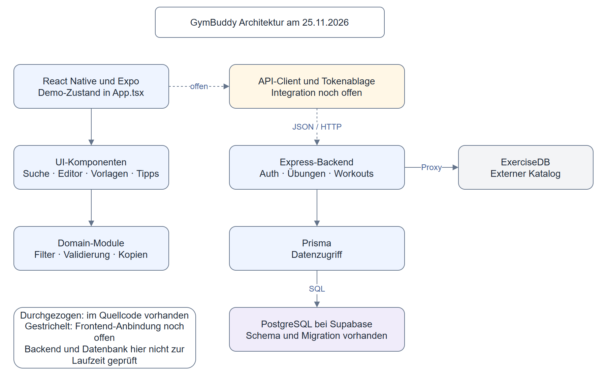
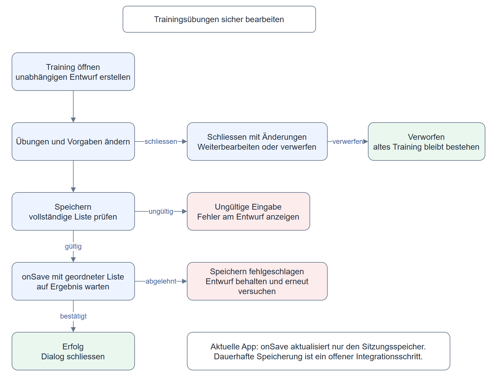
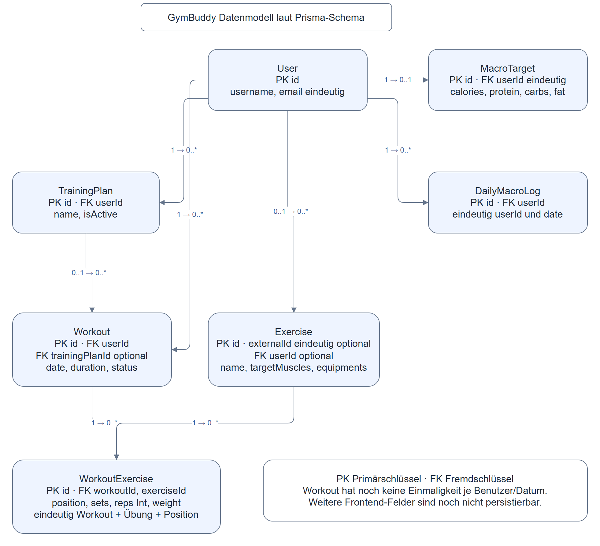

# Architektur und Integrationsverträge

Stand 25.11.2026. Die Aussagen zum Backend beruhen auf dem vorhandenen Quellcode, nicht auf einer in diesem Durchlauf getesteten Datenbankverbindung.

## Struktur und Änderung gegenüber dem Konzept

Editierbare Quelle: [Architektur in draw.io](diagrams/architecture.drawio).

Das ursprüngliche Konzept sah lokale JSON-Daten in AsyncStorage und keine Anmeldung vor. Der aktuelle Code enthält zusätzlich Express, eigene JWT-Anmeldung und Prisma für PostgreSQL. Supabase ist dabei als Datenbankhost vorgesehen; im Repository wird keine Supabase-Auth-Anmeldung verwendet. Diese Änderung benötigt einen abgestimmten Planungsstand und anschliessende Integrationstests. Die frühere Offline-Zusage ist durch den aktuellen Code noch nicht eingelöst.

`frontend/App.tsx` hält Demo-Workouts im React-Zustand. Komponenten zeigen diese Daten an und liefern Änderungen über Rückruffunktionen zurück. Die Domain-Module enthalten reine, getrennt getestete Suche, Validierung und Kopierlogik. `exerciseCatalogApi.ts` bildet die bestehende API-Antwort ab. Der Aufruf dieses Adapters ist in `App.tsx` noch nicht verdrahtet.

Im Backend nehmen Express-Routen Anfragen entgegen. Controller prüfen Teile der Eingaben und rufen Services auf. Workout-Services schränken Datenzugriffe auf `req.user.id` ein. Prisma verwendet die Konfiguration aus `backend/prisma/schema.prisma`. Die externe Übungsquelle wird durch einen serverseitigen Adapter angesprochen.

## Relevante Dateien

| Schicht | Dateien | Verantwortung |
| --- | --- | --- |
| Darstellung | ExerciseLibrary, WorkoutExerciseEditor, WorkoutTemplateLibrary, TemplateAdoptionModal, NutritionTipLibrary | Suche, Details, Entwürfe, Bestätigungen und Fehlermeldungen |
| Fachlogik | domain/exerciseCatalog.ts, workoutExercises.ts, workoutTemplates.ts, nutritionTips.ts | Filter, Werteprüfung, unverändernde Kopien |
| Katalogadapter | services/exerciseCatalogApi.ts | Antwort prüfen, API-IDs trennen, Fehler und Abbruch weiterreichen |
| Zusammensetzung | App.tsx | Demo-Daten und komponentenübergreifende Zustandsänderungen |
| Server | backend/server.js und src/routes, controllers, services | HTTP-Endpunkte, Authentifizierung und Datenzugriffe |
| Persistenz | backend/prisma/schema.prisma | Benutzer, Trainingspläne, Workouts, Übungen und Makrodaten |

## Ablauf beim Bearbeiten

Editierbare Quelle: [Bearbeitungsablauf in draw.io](diagrams/editing.drawio).

Der Editor kopiert die Übungszuordnungen beim Öffnen in einen Entwurf. Ändern und Sortieren verändern zunächst diesen Entwurf. Beim Speichern prüft die Domain-Logik die vollständige Liste. Erst bei gültigen Werten wird `onSave(rows)` aufgerufen. Der Dialog schliesst nach erfolgreicher Rückkehr; bei einer abgewiesenen Promise bleiben die Eingaben erhalten. Im aktuellen App-Aufrufer wird lediglich der React-Zustand ersetzt. Eine erfolgreiche Rückkehr bedeutet dort keine dauerhafte Speicherung.

Bei der Vorlagenübernahme werden Datum und ID des gewählten Kalendertags erhalten. Vorlagenname, Übungen, Muskelgruppen und Vorgaben werden unabhängig kopiert. Ein belegter Tag braucht eine zweite ausdrückliche Bestätigung. Wird der Tag zwischen Bestätigung und Speichern geändert, wird erneut bestätigt. Ein unveränderter Dialog wird bei einer normalen Eltern-Aktualisierung nicht neu initialisiert.

## Komponentenverträge

| Komponente | Eingaben | Ergebnis und Fehlerverhalten |
| --- | --- | --- |
| ExerciseLibrary | exercises, loading, error, onRetry; optional onSelect, selectedExerciseIds, hasMore/onLoadMore | Auswahl liefert vollständiges Exercise-Objekt; bereits ausgewählte Übung gesperrt; Filter beziehen sich auf die geladenen Einträge |
| WorkoutExerciseEditor | workout, exercises, onSave, onClose | onSave liefert vollständige geordnete WorkoutExercise-Liste; darf Promise ablehnen; bei Erfolg schliessen, bei Fehler Entwurf behalten; pro Workout neu montieren |
| WorkoutTemplateLibrary | templates, exercises, onAdoptTemplate | Ungültige Vorlagen sichtbar melden und Übernahme sperren |
| TemplateAdoptionModal | days, template, exercises, visible, onSubmit, onClose | onSubmit(dayId,time) erst nach Validierung/Bestätigung; Promise möglich; Schliessen nach Erfolg |
| NutritionTipLibrary | tips, loading, error, onRetry | Lokale kombinierte Suche und Kategorie, Details, Leer- und Fehleranzeige |

## Werte und Identität

Sätze sind ganze Zahlen von 1 bis 100. Gewicht ist optional, erlaubt 0 bis 1000 kg mit maximal zwei Dezimalstellen; Komma und Punkt werden akzeptiert. Pausen sind optional mit 0 bis 3600 Sekunden. Wiederholungen bleiben Text mit 1 bis 50 Zeichen, etwa `8–12` oder `30 Sek.`; Notizen haben höchstens 500 Zeichen. Diese Grenzen sind implementierte Projektregeln, keine medizinischen Trainingsempfehlungen.

Lokale Übungen verwenden lokale stabile IDs. Der Katalogadapter verwendet `api:<externalId>` und bewahrt `externalId` separat auf. Die Backend-ID einer gespeicherten Übung ist ein weiterer Identifikator. Diese Werte sind ausdrücklich zuzuordnen. Fehlende API-Angaben zu Schwierigkeit, Empfehlungen oder Sicherheit werden nicht erfunden.

## Bereits vorhandene HTTP-Endpunkte

| Methode und Pfad | Eingabe | Antwort laut Code |
| --- | --- | --- |
| GET /health | keine | status, app, environment; prüft keine Datenbank |
| POST /api/auth/register | username, email, password | 201 user und token; 400 ungültig; 409 bereits vorhanden |
| POST /api/auth/login | email, password | 200 user und token; 401 abgelehnt |
| GET /api/auth/me | Bearer-Token | user; 401 ungültige Sitzung, 404 Benutzer fehlt |
| GET /api/exercises | name, targetMuscles, equipments, limit, after und weitere Filter | exercises; 502 Quelle nicht verfügbar |
| GET /api/workouts | Bearer-Token; optional date/trainingPlanId | workouts einschliesslich geordneter Übungen |
| POST /api/workouts | Bearer-Token; name, optional date/duration/trainingPlanId | 201 workout |
| GET /api/workouts/:id | Bearer-Token | workout oder 404 |
| PATCH /api/workouts/:id/status | Bearer-Token; status GEPLANT/ERLEDIGT/VERPASST | workout; 400 ungültiger Status |
| DELETE /api/workouts/:id | Bearer-Token | 204 ohne Inhalt oder 404 |
| POST /api/workouts/:id/exercises | Bearer-Token; name, optional externalId, sets, reps, weight, position und Metadaten | 201 workoutExercise |

Nach erfolgreichem Login folgt der geschützte Abruf mit `Authorization: Bearer <token>`. Die UI darf vor der bestätigten Speicherung keinen dauerhaften Erfolg melden. Die aktuelle Katalogantwort verliert Cursor-Metadaten der externen Quelle; eine vollständige Suche über alle API-Seiten ist deshalb noch nicht nachgewiesen.

## Noch zu schliessende Vertragslücken

Die API hat bisher keinen allgemeinen Workout-Änderungsendpunkt und keine Endpunkte zum Entfernen, Ändern oder Sortieren vorhandener Übungszuordnungen. `reps` ist im Schema eine Ganzzahl; Wiederholungsbereiche und Zeitangaben des Frontends passen nicht verlustfrei hinein. Uhrzeit, Trainingsart, Intensität, Muskelgruppen, Pausen, Notizen und Vorlagenherkunft sind ebenfalls nicht vollständig persistierbar. Es fehlen ein ausdrücklicher Ruhetagsvertrag und eine datenbankseitige Einmaligkeit pro Benutzer und Datum.

Loris definiert vollständiges und atomisches Speichern sowie die fehlenden Felder. Gabriel bildet die Verträge im API-Client ab. Die vorgeschlagene vollständige Listenübergabe aus Abdullahs Editor ist bereits testbar; sie ist noch kein vorhandener HTTP-Endpunkt. Ein Bereich wie `8–12` darf nicht mit `parseInt` stillschweigend zu `8` werden. Das alte Training darf bei fehlgeschlagenem Ersatz nicht vorab gelöscht werden.

## Datenmodell und Schutz

Editierbare Quelle: [Datenmodell in draw.io](diagrams/data_model.drawio).

User besitzt TrainingPlan, Workout, eigene Exercise und DailyMacroLog. User hat höchstens ein MacroTarget. Workout gehört einem User und optional einem TrainingPlan; WorkoutExercise verbindet Workout und Exercise mit Position und Trainingswerten. DailyMacroLog hat einen zusammengesetzten eindeutigen Schlüssel aus Benutzer und Datum. Das Schema ist ausführbar im Repository enthalten; die Diagramme unterscheiden bestehende Tabellen von noch fehlenden Datenfeldern.

Passwörter werden im vorhandenen Auth-Service mit bcrypt gehasht; Tokens werden serverseitig mit JWT_SECRET signiert und laufen laut Code nach sieben Tagen ab. Das Löschen eines Tokens im Client widerruft einen bereits ausgestellten JWT nicht serverseitig. Datenbankzugang und JWT_SECRET bleiben im Backend. Vor einer produktiven Freigabe sind Benutzertrennung, Eingabeprüfung, Tokenablage, HTTPS, Datenbankexposition und Wiederherstellung tatsächlich zu prüfen. Diese Dokumentation bestätigt keine ausgeführte Sicherheitsabnahme.
