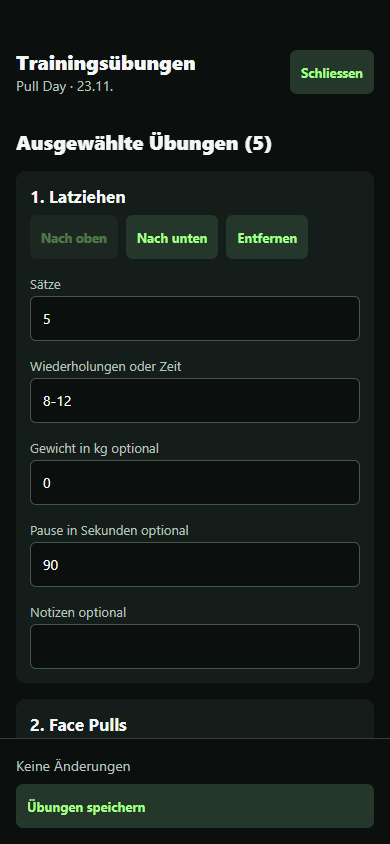

# GymBuddy bedienen

Diese Anleitung beschreibt den Prototyp vom 25.11.2026. Er startet mit Beispieldaten und braucht derzeit im Frontend keine Anmeldung. Änderungen bleiben nur bis zum Neuladen erhalten.

## Training und Übungen

Im Wochenkalender den gewünschten Tag wählen. Mit der vorhandenen Planungs-/Bearbeitungsaktion ein Training erfassen oder ändern. Die Aktion zum Bearbeiten der Übungen öffnet eine eigene Liste für diesen Tag. Ruhetage haben keinen Übungseditor.

Im Übungseditor unten eine Übung suchen und hinzufügen. Bereits enthaltene Übungen sind für eine zweite Auswahl gesperrt. Mit „Nach oben“ oder „Nach unten“ die Reihenfolge ändern; „Entfernen“ entfernt nur die Zuordnung dieses Entwurfs. Anschliessend Sätze, Wiederholungen oder Zeit und bei Bedarf Gewicht, Pause und Notizen eintragen.

„Übungen speichern“ prüft die Eingaben. Eine rote Meldung zeigt, welcher Wert zu korrigieren ist. Bei einem Speicherfehler bleiben die Eingaben im offenen Dialog erhalten. Beim Schliessen mit Änderungen kann man weiterbearbeiten oder die Änderungen verwerfen. Verwerfen lässt das zuvor gespeicherte Training unverändert.

## Übungsbibliothek

Das Suchfeld sucht nach dem Übungsnamen, unabhängig von Grossschreibung und äusseren Leerzeichen. Muskelgruppe, Gerät und Schwierigkeit lassen sich gleichzeitig filtern. Die Anzahl zeigt Treffer innerhalb des geladenen Katalogs. Mit dem Zurücksetzen werden alle Filter aufgehoben. Eine Übung aufklappen, um Anleitung und vorhandene Hinweise zu sehen. Bei fehlenden Angaben zeigt die App dies ausdrücklich an.

## Workout aus einer Vorlage

Unter „Workout-Vorlagen“ bei der gewünschten Vorlage „Auswählen“ wählen. Im Übernahmedialog sind die Übungen und Vorgaben sichtbar. Tag und Uhrzeit wählen. Die Uhrzeit muss beispielsweise `18:00` lauten. Bei einem belegten Tag zuerst „Im Kalender einplanen“ und danach die ausdrückliche Ersetzungsbestätigung wählen. „Ersetzen abbrechen“ oder Schliessen lässt das alte Training bestehen. Eine Übernahme erzeugt eine eigene Kopie: spätere Änderungen am Training verändern die Vorlage nicht.

## Ernährungstipps

Unter „Ernährungstipps“ einen Titel, ein Wort aus dem Inhalt oder ein Stichwort suchen. Eine Kategorie schränkt die Suche zusätzlich ein. „Tipp lesen“ öffnet Inhalt und Stichwörter; „Weniger anzeigen“ schliesst die Details. Wenn keine Treffer erscheinen, Suche oder Kategorie ändern oder die Ernährungsfilter zurücksetzen.

## Beispiel des Übungseditors

Die Felder gehören jeweils zur darüber genannten Übung. Die untere Speicheraktion bestätigt den vollständigen Entwurf; „Keine Änderungen“ bedeutet, dass seit dem Öffnen noch nichts geändert wurde.

## Bei Problemen

| Meldung oder Verhalten | Vorgehen |
| --- | --- |
| Keine Übung oder kein Tipp gefunden | Suchbegriff kürzen und Filter zurücksetzen |
| Übung fehlt im geladenen Katalog | Katalog erneut laden; bei weiterhin fehlender Zuordnung diese bewusst entfernen, keine Ersatzübung erraten |
| Ungültige Sätze, Gewicht oder Pause | Werte gemäss der Meldung korrigieren und nochmals speichern |
| Speichern fehlgeschlagen | Dialog offen lassen und erneut versuchen; erst nach Erfolg schliessen |
| Vorhandenes Training wird ersetzt | Tag nochmals prüfen; abbrechen, wenn das alte Training erhalten bleiben soll |
| Nach Neuladen sind Änderungen weg | Im aktuellen Prototyp sind das Sitzungseinträge; dauerhafte Speicherung ist noch offen |
| Untere Navigation wechselt keine Seite | Die Navigation ist noch nicht angeschlossen; die Funktionen sind derzeit auf der Hauptansicht angeordnet |
